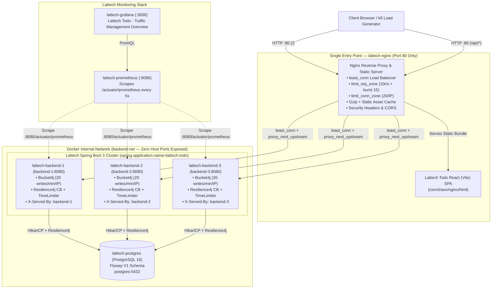

# Lattech Todo

[](https://github.com/aryanpandeyce/ToDo-Java/actions/workflows/ci-cd.yml)
[](https://github.com/aryanpandeyce/ToDo-Java/actions/workflows/pages.yml)


**Lattech Todo** is a full-stack reference platform built by **Lattech** to demonstrate **production traffic engineering, defense-in-depth rate limiting, high-availability failover, circuit breaking, and real-time observability** in system design and backend engineering interviews. The Todo domain logic is kept intentionally concise so that the **Nginx edge gateway, 3-node Spring Boot cluster, Bucket4j & Resilience4j protections, and Prometheus/Grafana telemetry** take center stage.

---

## Live Demo & Container Registry Links

| Resource | Public URL | Description |
| :--- | :--- | :--- |
| **Live App (GitHub Pages)** | [https://aryanpandeyce.github.io/ToDo-Java/](https://aryanpandeyce.github.io/ToDo-Java/) | React (Vite) SPA with live `X-Served-By` & Bucket4j telemetry banner |
| **Live API Health (Render)** | [https://lattech-todo-backend.onrender.com/actuator/health](https://lattech-todo-backend.onrender.com/actuator/health) | Spring Boot 3 Actuator readiness, DB, and CircuitBreaker probe |
| **Live Todo REST API** | [https://lattech-todo-backend.onrender.com/api/todos](https://lattech-todo-backend.onrender.com/api/todos) | Public `GET`/`POST`/`PUT`/`DELETE` API guarded by Bucket4j & Resilience4j |
| **CI/CD Pipeline Status** | [GitHub Actions Workflows](https://github.com/aryanpandeyce/ToDo-Java/actions) | Automated Maven tests, Vite build, GHCR image push, and Pages deploy |
| **Backend Docker Image (GHCR)** | [`ghcr.io/aryanpandeyce/lattech-todo-backend:latest`](https://github.com/aryanpandeyce/ToDo-Java/pkgs/container/ToDo-Java%2Flattech-todo-backend) | Multi-stage Eclipse Temurin JRE 17 container image |
| **Frontend / Gateway Image (GHCR)** | [`ghcr.io/aryanpandeyce/lattech-todo-frontend:latest`](https://github.com/aryanpandeyce/ToDo-Java/pkgs/container/ToDo-Java%2Flattech-todo-frontend) | Multi-stage Nginx 1.27 + Vite static SPA container image |

> **Note 1 (Render Free Tier Cold Start)**: *Free tier backend may sleep after inactivity; first request can take ~30-60s to wake up the JVM container.*
>
> **Note 2 (Full Traffic Management Cluster)**: *Full traffic management demo (Nginx LB, 3 replicas, Grafana) runs via docker compose locally or on a VPS.*

---

## 1. Architecture Diagram



---

## 2. Request-Flow Sequence Diagram (Load Balancing, 429 Rate Limiting & Failover)

```mermaid
sequenceDiagram
    autonumber
    actor Client as Client / k6
    participant Nginx as lattech-nginx (Edge Gateway :80)
    participant B1 as lattech-backend-1 (:8080)
    participant B2 as lattech-backend-2 (:8080)
    participant B3 as lattech-backend-3 (:8080)
    participant DB as lattech-postgres (:5432)

    rect rgb(20, 45, 75)
    Note over Client,DB: Path A — Normal least_conn Load Balancing across 3 Replicas
    Client->>Nginx: POST /api/todos {"title": "Ship Lattech v1"}
    Nginx->>Nginx: Check limit_conn (<=20) & limit_req (<=10r/s + burst 15)
    Nginx->>B1: Proxy request (least_conn selects backend-1)
    B1->>B1: InstanceHeaderFilter sets X-Served-By: backend-1
    B1->>B1: RateLimitFilter (Bucket4j) consumes 1 token (19/20 left)
    B1->>DB: Resilience4j CircuitBreaker + TimeLimiter (3s) -> INSERT
    DB-->>B1: Row persisted
    B1-->>Nginx: 201 Created (X-Served-By: backend-1, X-Rate-Limit-Remaining: 19)
    Nginx-->>Client: 201 Created + Security Headers + Gzip
    end

    rect rgb(75, 45, 20)
    Note over Client,B2: Path B — Two-Tier Rate Limiting (HTTP 429 Too Many Requests)
    Client->>Nginx: Volumetric Burst (>25 req/s from single IP)
    Nginx-->>Client: 429 Too Many Requests (Nginx Edge /429.json + Retry-After: 5)
    Client->>Nginx: 21st Write Request in 1 min (within Nginx limit, exceeds App quota)
    Nginx->>B2: Proxy POST /api/todos (least_conn selects backend-2)
    B2->>B2: Bucket4j token bucket exhausted (0 tokens left)
    B2-->>Nginx: 429 Too Many Requests (Retry-After: 3, X-Served-By: backend-2)
    Nginx-->>Client: 429 Too Many Requests (Bucket4j JSON payload)
    end

    rect rgb(20, 65, 50)
    Note over Client,DB: Path C — Zero-Downtime Automatic Failover (proxy_next_upstream)
    Client->>Nginx: GET /api/todos
    Nginx->>B2: Route to backend-2 (Container stopped / TCP timeout / 502)
    B2--xNginx: Connection refused / timeout (max_fails=2 fail_timeout=10s)
    Nginx->>Nginx: proxy_next_upstream marks backend-2 down & retries immediately
    Nginx->>B3: Retry GET /api/todos on healthy backend-3
    B3->>DB: SELECT * FROM todos ORDER BY created_at DESC
    DB-->>B3: Todo list
    B3-->>Nginx: 200 OK (X-Served-By: backend-3)
    Nginx-->>Client: 200 OK (Client experiences 0 errors!)
    end
```



---

## 3. How to Run Locally with One Command

```bash
# Launch PostgreSQL, 3 Spring Boot replicas, Nginx Gateway, Prometheus, and Grafana
docker compose up --build -d
```

| Service | Container Name | URL / Port | Credentials / Notes |
| :--- | :--- | :--- | :--- |
| **Lattech Todo Web App & API Gateway** | `lattech-nginx` | http://localhost (Port `80`) | Only external application entry point |
| **Gateway Health Probe** | `lattech-nginx` | http://localhost/api/health | Proxies to `/actuator/health` |
| **Grafana Dashboard** | `lattech-grafana` | http://localhost:3000 | `admin` / `admin` -> *Lattech Todo - Traffic Management Overview* |
| **Prometheus UI** | `lattech-prometheus` | http://localhost:9090 | Scrapes `backend-1/2/3:8080/actuator/prometheus` |
| **Spring Boot Replicas (x3)** | `lattech-backend-1/2/3` | Internal `:8080` (`backend-net`) | Image: `ghcr.io/aryanpandeyce/lattech-todo-backend` |
| **PostgreSQL 16** | `lattech-postgres` | Internal `:5432` (`backend-net`) | Isolated from host network |

---

## 4. Traffic Management Explained — All 10 Techniques Summary Table

| # | Technique | What Problem It Solves | Where Configured (File & Lines) | Exact Demo Command |
| :- | :--- | :--- | :--- | :--- |
| **1** | **Load Balancing (`least_conn` + `X-Served-By`)** | Distributes traffic across 3 stateless replicas, routing requests away from any instance with slower active connections. | [`nginx/nginx.conf`](file:///c:/Users/aryan/OneDrive/Desktop/ToDo-Java/nginx/nginx.conf#L66-L74) (L66–74)<br/>[`InstanceHeaderFilter.java`](file:///c:/Users/aryan/OneDrive/Desktop/ToDo-Java/backend/src/main/java/com/example/todo/filter/InstanceHeaderFilter.java#L16-L43) (L16–43) | `for i in $(seq 1 6); do curl -s -D - -o /dev/null http://localhost/api/todos \| grep -i "X-Served-By"; done` |
| **2** | **Health Checks & Failover (`max_fails`, `proxy_next_upstream`)** | Detects crashed/unresponsive replicas, ejects them for `10s`, and transparently retries in-flight requests on healthy nodes. | [`nginx/nginx.conf`](file:///c:/Users/aryan/OneDrive/Desktop/ToDo-Java/nginx/nginx.conf#L69-L71) (L69–71, L148–150)<br/>[`docker-compose.yml`](file:///c:/Users/aryan/OneDrive/Desktop/ToDo-Java/docker-compose.yml#L20-L25) (L20–25) | `docker stop lattech-backend-2 && curl -i http://localhost/api/todos && docker start lattech-backend-2` |
| **3** | **Two-Tier Rate Limiting (`limit_req_zone` + `Bucket4j`)** | Nginx blocks volumetric L7 floods (`10r/s` + `burst 15`); Spring Boot Bucket4j limits mutating writes (`20/min/IP`) with `Retry-After`. | [`nginx/nginx.conf`](file:///c:/Users/aryan/OneDrive/Desktop/ToDo-Java/nginx/nginx.conf#L53-L54) (L53–54, L100–119)<br/>[`RateLimitFilter.java`](file:///c:/Users/aryan/OneDrive/Desktop/ToDo-Java/backend/src/main/java/com/example/todo/filter/RateLimitFilter.java#L25-L107) (L25–107) | `for i in $(seq 1 22); do curl -s -o /dev/null -w "Req $i: %{http_code}\n" -X POST http://localhost/api/todos -H "Content-Type: application/json" -d "{\"title\":\"Task $i\"}"; done` |
| **4** | **Connection Limiting (`limit_conn_zone`)** | Caps concurrent TCP connections per IP (`20` on `/api/`, `30` on `/`) to prevent Slowloris & socket exhaustion attacks. | [`nginx/nginx.conf`](file:///c:/Users/aryan/OneDrive/Desktop/ToDo-Java/nginx/nginx.conf#L59-L60) (L59–60, L122, L184) | `seq 1 40 \| xargs -n1 -P40 -I{} curl -s -o /dev/null -w "%{http_code}\n" http://localhost/api/todos \| sort \| uniq -c` |
| **5** | **Timeouts, Payload Limits & Circuit Breaker** | Rejects `>1MB` bodies (`413`), bounds upstream waits (`2s` connect, `5s` read), and trips Resilience4j CircuitBreaker / `3s` TimeLimiter on DB slowdowns. | [`nginx/nginx.conf`](file:///c:/Users/aryan/OneDrive/Desktop/ToDo-Java/nginx/nginx.conf#L86-L88) (L86–88, L153–159)<br/>[`TodoService.java`](file:///c:/Users/aryan/OneDrive/Desktop/ToDo-Java/backend/src/main/java/com/example/todo/service/TodoService.java#L79-L104) (L79–104) | `dd if=/dev/zero bs=1M count=2 2>/dev/null \| tr '\0' 'a' \| curl -s -o /dev/null -w "HTTP %{http_code}\n" -X POST http://localhost/api/todos -H "Content-Type: application/json" --data-binary @-` |
| **6** | **Caching & Gzip Compression** | Compresses JSON/JS/CSS (`gzip_comp_level 6`) and sets 1-year `immutable` cache headers on Vite hashed bundles (`/assets/*`). | [`nginx/nginx.conf`](file:///c:/Users/aryan/OneDrive/Desktop/ToDo-Java/nginx/nginx.conf#L35-L47) (L35–47, L173–178) | `curl -s -I -H "Accept-Encoding: gzip" http://localhost/` |
| **7** | **Security Hardening (Headers, CORS, Tokens)** | Hides Nginx version (`server_tokens off`), enforces CSP, `X-Frame-Options`, `nosniff`, and exposes `X-Served-By` / `Retry-After` via CORS. | [`nginx/nginx.conf`](file:///c:/Users/aryan/OneDrive/Desktop/ToDo-Java/nginx/nginx.conf#L15) (L15, L93–97, L125–134) | `curl -s -I http://localhost/api/todos` |
| **8** | **Single Entry Point & Port Consolidation** | Exposes only Port `80` on `lattech-nginx`; PostgreSQL (`5432`) and backends (`8080`) use internal `expose` on `backend-net`. | [`docker-compose.yml`](file:///c:/Users/aryan/OneDrive/Desktop/ToDo-Java/docker-compose.yml#L16-L17) (L16–17, L43–44, L109–110) | `docker compose ps` (Verify only `lattech-nginx` binds `0.0.0.0:80->80/tcp` for app traffic) |
| **9** | **Prometheus + Grafana Monitoring** | Scrapes Micrometer metrics every 5s and visualizes per-replica RPS, P95 latency, 429/5xx error rates, and CircuitBreaker state. | [`prometheus.yml`](file:///c:/Users/aryan/OneDrive/Desktop/ToDo-Java/nginx/monitoring/prometheus.yml#L1-L15) (L1–15)<br/>[`traffic-overview.json`](file:///c:/Users/aryan/OneDrive/Desktop/ToDo-Java/nginx/monitoring/grafana/dashboards/traffic-overview.json#L1-L85) | `curl -s http://localhost:9090/api/v1/targets \| grep -o '"health":"up"'` |
| **10** | **Automated Load, Spike & Failover Test (`k6`)** | Simulates steady load + a 35 req/s spike to prove `least_conn` distribution, `429` enforcement, and zero `5xx` errors on replica kill. | [`loadtest/traffic-test.js`](file:///c:/Users/aryan/OneDrive/Desktop/ToDo-Java/loadtest/traffic-test.js#L1-L116) (L1–116) | `docker run --rm -i --network host grafana/k6 run - < loadtest/traffic-test.js` |

---

## 5. Deep-Dive Demo Outputs

### Demo A: Load Balancing & Replica Telemetry (`X-Served-By`)
```bash
for i in $(seq 1 6); do
  curl -s -D - -o /dev/null http://localhost/api/todos | grep -i "X-Served-By"
done
# Output:
# X-Served-By: backend-1
# X-Served-By: backend-2
# X-Served-By: backend-3
# X-Served-By: backend-1
# X-Served-By: backend-2
# X-Served-By: backend-3
```

### Demo B: Triggering HTTP 429 with `Retry-After` (Bucket4j Application Quota)
```bash
for i in $(seq 1 21); do
  curl -s -o /dev/null -w "Write $i -> HTTP %{http_code}\n" \
    -X POST http://localhost/api/todos \
    -H "Content-Type: application/json" \
    -d "{\"title\":\"Lattech Task $i\"}"
done
# Writes 1..20 -> HTTP 201
# Write 21     -> HTTP 429 (with Retry-After header & JSON error body)
```

### Demo C: Live Replica Kill During Load Test (Zero-Downtime Failover)
```bash
# Terminal 1: Start k6 test
docker run --rm -i --network host grafana/k6 run - < loadtest/traffic-test.js

# Terminal 2: Stop replica 2 mid-flight
docker stop lattech-backend-2
```
**Expected k6 Summary**:
- `served_by_backend_1`, `served_by_backend_2`, `served_by_backend_3` record balanced hits until `lattech-backend-2` stops; `backend-1` and `backend-3` seamlessly handle the rest.
- `rate_limited_429_nginx_edge` and `rate_limited_429_bucket4j_app` capture spike throttling.
- `unexpected_5xx_error_rate`: `0.00%` (passes threshold `rate<0.01`).

---

## 6. Workspace Features & Screenshots

### Key Application & SaaS Workspace Features
- **Todoist / Notion-Inspired SaaS Layout**: Left navigation sidebar (`Inbox`, `Today`, `Upcoming`, `Completed`), custom color-coded **Lists / Folders** (`/api/lists`) with live task counters, and responsive mobile drawer.
- **Rich Task Management**: Priority levels (`LOW`, `MEDIUM`, `HIGH`), due date chips with automatic red **Overdue** and **Due Today** indicators, list labels, hover edit/delete actions, quick-add bar, and a full create/edit modal (zero raw database IDs shown in UI).
- **Server & Client Filtering, Search, and Sorting**: Filter by `listId`, `status`, `priority`, and search query `q` (`GET /api/todos?listId=&status=&priority=&q=&sort=dueDate|priority|createdAt`).
- **Light / Dark Theme & Resilient UX**: Default light theme with instant dark-mode toggle, `12s` `AbortController` request timeout, retryable error banner, skeleton loaders, and non-blocking toast notifications.
- **Dedicated `/monitor` Traffic Engineering Page**: Moved out of the main workspace so the productivity UI stays clean; features a live bar chart of requests served per replica (`backend-1/2/3`), Bucket4j write quota gauge, **Send 20 test requests** load-balancing simulator, and **Spam writes (Trigger 429)** button, while the main workspace shows only a subtle `Served by: <instance>` footer pill.

### Visual Walkthrough & Screenshots

1. **Lattech Todo Main SaaS Workspace (Light & Dark Themes)**
   - Shows the left sidebar with custom color-dot Lists, top search/sort bar, filter chips, quick-add bar, priority/due-date task cards, and subtle `Served by: backend-1` footer badge.
   - *Placeholder*: `docs/screenshots/lattech-workspace-light.png` & `docs/screenshots/lattech-workspace-dark.png`
2. **Dedicated Traffic Monitor Page (`/#/monitor`)**
   - Shows the live per-replica request distribution bar chart (`backend-1`, `backend-2`, `backend-3`), `X-Served-By` badge, Bucket4j write quota counter, **Send 20 test requests** button, and **Spam writes (Trigger 429)** toast notification.
   - *Placeholder*: `docs/screenshots/lattech-traffic-monitor-page.png`
3. **Grafana Dashboard — "Lattech Todo - Traffic Management Overview" (`http://localhost:3000`)**
   - Displays 5 real-time panels: *Requests / Sec by Backend Replica*, *P95 Request Latency (ms)*, *Error & Rate-Limit Rate (HTTP 429/5xx)*, *Resilience4j Circuit Breaker State*, and *JVM Active Threads*.
   - *Placeholder*: `docs/screenshots/lattech-grafana-dashboard.png`
4. **k6 Load & Failover Terminal Output**
   - Shows `0.00%` 5xx error rate while `lattech-backend-2` is terminated mid-test alongside positive counters for `served_by_backend_1/2/3` and `rate_limited_429_nginx_edge`.
   - *Placeholder*: `docs/screenshots/lattech-k6-results.png`

---

## 7. Two-Minute Interview Talking Points

> **"Walk me through how you architected traffic management in Lattech Todo."**

1. **Single Entry Point & Network Isolation (0:00 – 0:25)**
   *"In Lattech Todo, all external traffic enters through a single Nginx gateway container (`lattech-nginx`) on port 80, which serves our static React Vite bundle at `/` and proxies `/api/*` to three stateless Spring Boot 3 replicas (`lattech-backend-1/2/3`). Neither PostgreSQL nor the Spring Boot containers expose ports to the host—they communicate strictly over an internal Docker bridge network so no client can bypass edge policies."*

2. **Load Balancing & Zero-Downtime Failover (0:25 – 0:55)**
   *"At the Nginx upstream layer, I configured `least_conn` instead of naive round-robin so traffic automatically steers away from any replica experiencing a slow query or GC pause. Every replica stamps an `X-Served-By` response header so routing is visible in the Lattech UI and in k6 metrics. We pair passive health checks (`max_fails=2`, `fail_timeout=10s`) with `proxy_next_upstream`—if a container crashes mid-request, Nginx transparently retries on the next healthy replica before the user ever sees an error."*

3. **Defense-in-Depth Rate & Connection Limiting (0:55 – 1:30)**
   *"We enforce rate limiting at two layers. First, at the Nginx edge, `limit_req_zone` (10 req/s with a burst of 15) and `limit_conn_zone` (20 concurrent connections per IP) absorb volumetric floods and Slowloris attacks before they touch a single JVM thread. Second, inside Spring Boot, a Bucket4j filter enforces domain-aware quotas—allowing fast `GET` reads to scale freely while restricting state-mutating `POST/PUT/DELETE` operations to 20 per minute per IP, returning `HTTP 429` with a `Retry-After` header."*

4. **Downstream Protection & Observability (1:30 – 2:00)**
   *"To prevent cascading database failures, every JPA call in `TodoService` is guarded by a Resilience4j `CircuitBreaker` and a 3-second `TimeLimiter`. If PostgreSQL slows down or fails, the circuit opens and fails fast with `503 Service Unavailable` rather than exhausting HikariCP and Tomcat thread pools. Finally, Prometheus scrapes `/actuator/prometheus` across all 3 replicas every 5 seconds and feeds our pre-provisioned **Lattech Todo - Traffic Management Overview** dashboard in Grafana."*

---

## 8. Deployment Guide

### Option A: Cloud Public Hosting (GitHub Pages Frontend + Render Backend & PostgreSQL)

This repository includes a zero-config Render Blueprint ([`render.yaml`](file:///c:/Users/aryan/OneDrive/Desktop/ToDo-Java/render.yaml)) and an automated GitHub Pages workflow ([`.github/workflows/pages.yml`](file:///c:/Users/aryan/OneDrive/Desktop/ToDo-Java/.github/workflows/pages.yml)).

1. **Deploy the Backend + PostgreSQL on Render (`render.yaml`)**:
   - Sign in to [Render](https://dashboard.render.com/) and click **New +** -> **Blueprint**.
   - Connect your GitHub repository: `aryanpandeyce/ToDo-Java` (branch `main`).
   - Render automatically detects [`render.yaml`](file:///c:/Users/aryan/OneDrive/Desktop/ToDo-Java/render.yaml) and provisions:
     - `lattech-postgres`: Managed PostgreSQL 16 database (`tododb`).
     - `lattech-todo-backend`: Docker web service built from `backend/Dockerfile` with `/actuator/health` probe, `server.forward-headers-strategy=framework` for accurate per-IP Bucket4j rate limiting behind Render's load balancer, and CORS enabled for `https://aryanpandeyce.github.io`.
   - Copy your deployed Render service URL (e.g., `https://lattech-todo-backend.onrender.com`).

2. **Enable GitHub Pages & Configure `VITE_API_BASE_URL`**:
   - In your GitHub repo (`https://github.com/aryanpandeyce/ToDo-Java`), go to **Settings** -> **Pages**.
   - Under **Build and deployment** -> **Source**, select **GitHub Actions**.
   - Go to **Settings** -> **Secrets and variables** -> **Actions** -> **Variables** tab -> **New repository variable**:
     - **Name**: `VITE_API_BASE_URL`
     - **Value**: `https://<RENDER_URL>/api` *(e.g. `https://lattech-todo-backend.onrender.com/api`)*
   - Go to the **Actions** tab -> **Deploy Frontend to GitHub Pages** -> click **Run workflow** (or push any commit to `main`).
   - Your live app will be published at: **https://aryanpandeyce.github.io/ToDo-Java/**

---

### Option B: Full Traffic Management Stack on a VPS (Ubuntu / Debian + Docker Compose)

To run the complete 7-container architecture (Nginx `least_conn` load balancer, 3 Spring Boot replicas, PostgreSQL, Prometheus, and Grafana) on an Ubuntu/Debian VPS (DigitalOcean, AWS EC2, Hetzner, Linode):

```bash
# 1. SSH into your VPS and install Docker + Docker Compose plugin
curl -fsSL https://get.docker.com | sh

# 2. Clone the repository
git clone https://github.com/aryanpandeyce/ToDo-Java.git
cd ToDo-Java

# 3. Create your production .env from the template and set strong passwords
cp .env.example .env
nano .env

# 4. Build and launch all 7 containers in detached mode
docker compose up --build -d

# 5. Verify all containers are healthy
docker compose ps
```

- **App & Nginx Gateway**: `http://<VPS_IP>` (Port `80`)
- **Grafana Dashboard**: `http://<VPS_IP>:3000`
- **Prometheus**: `http://<VPS_IP>:9090`

---

*Built by **Lattech** — Platform & Infrastructure Engineering.*
