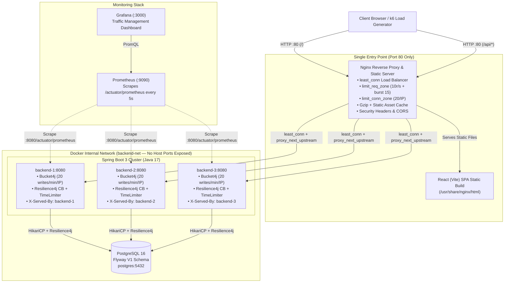

# Production-Grade Traffic Management & High-Availability Todo Platform

A full-stack monorepo designed specifically to demonstrate **production traffic engineering, resilience patterns, and observability** in system design & backend engineering interviews. The Todo application logic is intentionally clean and minimal so the **infrastructure, reverse proxy, rate limiters, circuit breakers, and failover mechanisms** take center stage.

---

## 1. System Architecture Diagram



---

## 2. How to Run Locally with One Command

```bash
# 1. Start the entire stack (PostgreSQL + 3 Spring Boot replicas + Nginx + Prometheus + Grafana)
docker compose up --build -d
```

Once healthy (approx. 30–45 seconds):
- **Todo Application + Live Telemetry UI (Nginx Gateway)**: http://localhost
- **API Health Gateway Check**: http://localhost/api/health
- **Prometheus UI**: http://localhost:9090
- **Grafana Dashboard**: http://localhost:3000 (Login: `admin` / `admin` -> Dashboards -> **Todo Traffic Management & HA Overview**)

To stop and clean up:
```bash
docker compose down -v
```

---

## 3. Traffic Management Explained (File, Line, Problem Solved & Live Demo)

### 3.1 Load Balancing (`least_conn` across 3 Replicas + `X-Served-By` Header)
- **What problem it solves**: Prevents any single JVM instance from becoming a CPU/thread bottleneck. Unlike naive round-robin, `least_conn` routes each new request to the replica with the fewest active connections, preventing request pile-ups behind a slow query.
- **Where it is configured**:
  - Nginx upstream block: `nginx/nginx.conf` (Lines 66–74)
  - 3 replicas definition: `docker-compose.yml` (Lines 54–100)
  - Instance response header filter: `backend/src/main/java/com/example/todo/filter/InstanceHeaderFilter.java` (Lines 16–43)
- **How to demo it**:
  ```bash
  for i in $(seq 1 6); do
    curl -s -D - -o /dev/null http://localhost/api/todos | grep -i "X-Served-By"
  done
  ```
- **Expected Output**:
  ```text
  X-Served-By: backend-1
  X-Served-By: backend-2
  X-Served-By: backend-3
  X-Served-By: backend-1
  X-Served-By: backend-2
  X-Served-By: backend-3
  ```

---

### 3.2 Health Checks & Automatic Failover (`max_fails`, `fail_timeout`, `proxy_next_upstream`)
- **What problem it solves**: Eliminates single points of failure. If one replica crashes, hangs, or returns HTTP 5xx, Nginx transparently retries the request against the next healthy replica within milliseconds (`proxy_next_upstream`) and temporarily ejects the unhealthy node for `10s` after `2` failures.
- **Where it is configured**:
  - Passive health checks: `nginx/nginx.conf` (Lines 69–71: `max_fails=2 fail_timeout=10s`)
  - Upstream retry rules: `nginx/nginx.conf` (Lines 148–150: `proxy_next_upstream error timeout http_500 http_502 http_503 http_504`)
  - Container health probes: `docker-compose.yml` (Lines 20–24) and `backend/src/main/resources/application.yml` (Lines 23–30)
- **How to demo it**:
  ```bash
  # Kill replica 2 and immediately send traffic
  docker stop todo-backend-2
  for i in $(seq 1 6); do
    curl -s -D - -o /dev/null http://localhost/api/todos | grep -E "HTTP/|X-Served-By"
  done
  # Bring replica 2 back online
  docker start todo-backend-2
  ```
- **Expected Output**:
  Every request returns `HTTP/1.1 200 OK` served seamlessly by `backend-1` and `backend-3` with zero 502/504 errors exposed to the client.

---

### 3.3 Two-Tier Rate Limiting (Nginx Edge `limit_req_zone` + Spring Boot `Bucket4j`)
- **What problem it solves**:
  1. **Layer 7 Edge Protection (Nginx)**: Absorbs volumetric floods and DDoS bursts before they consume backend JVM threads (`10 req/s` per IP with a `burst=15 nodelay` queue).
  2. **Application Write Quota (Bucket4j)**: Enforces domain-specific write quotas (`20 write requests/min` per IP on `POST/PUT/DELETE /api/todos`) while allowing read (`GET`) traffic to flow freely.
- **Where it is configured**:
  - Nginx rate zone & status: `nginx/nginx.conf` (Lines 53–54, Line 119)
  - Custom 429 JSON & HTML handler: `nginx/nginx.conf` (Lines 100–112) & `nginx/429.html`
  - Bucket4j Per-IP Filter: `backend/src/main/java/com/example/todo/filter/RateLimitFilter.java` (Lines 25–107)
- **How to demo Application Rate Limiting (Bucket4j - 20 writes/min)**:
  ```bash
  for i in $(seq 1 22); do
    curl -s -o /dev/null -w "Req $i: HTTP %{http_code}\n" \
      -X POST http://localhost/api/todos \
      -H "Content-Type: application/json" \
      -d "{\"title\":\"Task $i\"}"
  done
  ```
- **Expected Output**:
  ```text
  Req 1: HTTP 201
  ...
  Req 20: HTTP 201
  Req 21: HTTP 429
  Req 22: HTTP 429
  ```
  Inspecting headers on the 21st request (`curl -i`) shows `Retry-After: 3` and JSON `"error": "Too Many Requests (Bucket4j)"`.
- **How to demo Edge Rate Limiting (Nginx - >25 concurrent requests)**:
  ```bash
  seq 1 40 | xargs -n1 -P40 -I{} curl -s -o /dev/null -w "HTTP %{http_code}\n" http://localhost/api/todos | sort | uniq -c
  ```
- **Expected Output**:
  ```text
       25 HTTP 200
       15 HTTP 429
  ```

---

### 3.4 Connection Limiting (`limit_conn_zone`)
- **What problem it solves**: Defends against Slowloris attacks and socket exhaustion where a single client opens hundreds of concurrent TCP connections to starve the worker pool.
- **Where it is configured**:
  - Zone definition: `nginx/nginx.conf` (Lines 59–60: `limit_conn_zone $binary_remote_addr zone=addr_conn_limit:10m`)
  - API & SPA enforcement: `nginx/nginx.conf` (Line 122: `limit_conn addr_conn_limit 20;` and Line 184: `limit_conn addr_conn_limit 30;`)
- **How to demo it**:
  Run the parallel `xargs -P40` burst command above or the k6 spike test; concurrent connections above 20 from a single IP receive `429`.

---

### 3.5 Timeouts, Payload Limits, and Proxy Buffers
- **What problem it solves**: Prevents large payload OOM attacks (`client_max_body_size 1m`), slow-client stalling (`client_body_timeout`), and hung upstream sockets (`proxy_connect_timeout`, `proxy_read_timeout`), while proxy buffers allow backend Tomcat threads to flush responses into Nginx memory and immediately free up the JVM thread even if the client is on a slow mobile network.
- **Where it is configured**:
  - Nginx body limit & client timeouts: `nginx/nginx.conf` (Lines 86–88)
  - Nginx upstream timeouts & buffers: `nginx/nginx.conf` (Lines 153–159)
  - Resilience4j CircuitBreaker & TimeLimiter on DB calls: `backend/src/main/resources/application.yml` (Lines 39–55) and `backend/src/main/java/com/example/todo/service/TodoService.java` (Lines 79–104)
- **How to demo it (Oversized Payload > 1MB)**:
  ```bash
  dd if=/dev/zero bs=1M count=2 2>/dev/null | tr '\0' 'a' | \
    curl -s -o /dev/null -w "HTTP %{http_code}\n" -X POST http://localhost/api/todos \
    -H "Content-Type: application/json" --data-binary @-
  ```
- **Expected Output**:
  ```text
  HTTP 413
  ```
  (`413 Payload Too Large` rejected immediately at the Nginx edge without touching Spring Boot).

---

### 3.6 Caching & Gzip Compression
- **What problem it solves**: Cuts bandwidth usage by 60–80% on JSON and JS/CSS payloads via `gzip` and offloads repeat static asset requests completely to the browser cache (`Cache-Control: public, max-age=31536000, immutable`) on Vite's content-hashed `/assets/*` files.
- **Where it is configured**:
  - Gzip configuration: `nginx/nginx.conf` (Lines 35–47)
  - Immutable asset caching: `nginx/nginx.conf` (Lines 173–178)
- **How to demo it**:
  ```bash
  curl -s -I -H "Accept-Encoding: gzip" http://localhost/
  ```
- **Expected Output**:
  ```text
  HTTP/1.1 200 OK
  Content-Encoding: gzip
  Cache-Control: no-cache
  ```

---

### 3.7 Security Hardening (CORS, Security Headers, Hidden Server Tokens)
- **What problem it solves**: Prevents Reconnaissance (`server_tokens off` hides Nginx version), Clickjacking (`X-Frame-Options: SAMEORIGIN`), MIME sniffing (`X-Content-Type-Options: nosniff`), XSS (`Content-Security-Policy`), and unauthorized cross-origin calls.
- **Where it is configured**:
  - `server_tokens off`: `nginx/nginx.conf` (Line 15)
  - Security headers: `nginx/nginx.conf` (Lines 93–97)
  - CORS handling: `nginx/nginx.conf` (Lines 125–134)
- **How to demo it**:
  ```bash
  curl -s -I http://localhost/api/todos
  ```
- **Expected Output**:
  ```text
  Server: nginx
  X-Served-By: backend-1
  X-Frame-Options: SAMEORIGIN
  X-Content-Type-Options: nosniff
  X-XSS-Protection: 1; mode=block
  Referrer-Policy: strict-origin-when-cross-origin
  Access-Control-Expose-Headers: X-Served-By, X-Rate-Limit-Remaining, Retry-After
  ```

---

### 3.8 Single Entry Point & Port Consolidation
- **What problem it solves**: Enforces network isolation (Zero Trust internal topology). External clients can only reach Port 80 on the Nginx container. PostgreSQL (`5432`) and all 3 Spring Boot instances (`8080`) use `expose` instead of `ports` on the internal Docker bridge network (`backend-net`), making direct database or backend bypass impossible from the host network.
- **Where it is configured**:
  - `docker-compose.yml` (Lines 16–17, 43–44, 108–109)
  - `nginx/nginx.conf` (Line 117 `/api/` and Line 183 `/`)

---

### 3.9 Observability: Prometheus + Grafana
- **What problem it solves**: Provides real-time visibility into per-replica RPS, P95 latency, HTTP 429/5xx rates, JVM thread pools, and Resilience4j circuit breaker states.
- **Where it is configured**:
  - Actuator Prometheus exposure: `backend/src/main/resources/application.yml` (Lines 20–37)
  - Prometheus scrape config: `nginx/monitoring/prometheus.yml` (Lines 1–15)
  - Pre-provisioned Grafana dashboard: `nginx/monitoring/grafana/dashboards/traffic-overview.json`

---

### 3.10 Automated Load, Spike & Failover Testing (k6)
- **What problem it solves**: Validates under realistic concurrency that `least_conn` balances traffic evenly, `429` rate limiters trigger during traffic spikes, and killing a replica mid-flight produces zero `5xx` errors.
- **Where it is configured**:
  - `loadtest/traffic-test.js` (Lines 1–116)
- **How to demo it**:
  ```bash
  # Terminal 1: Run the 45-second k6 load & spike test
  docker run --rm -i --network host grafana/k6 run - < loadtest/traffic-test.js

  # Terminal 2 (at ~10 seconds into the test): Kill one backend replica to test live failover
  docker stop todo-backend-2
  ```
- **Expected Output**:
  - `served_by_backend_1`, `served_by_backend_2`, `served_by_backend_3` counters show traffic split across replicas until `backend-2` is stopped, after which `backend-1` and `backend-3` absorb 100% of requests.
  - `rate_limited_429_nginx_edge` and `rate_limited_429_bucket4j_app` increment during the 15s burst phase.
  - `unexpected_5xx_error_rate` passes threshold `rate<0.01` (`0.00%`).

---

## 4. Two-Minute Interview Talking Points

> **"Walk me through how you designed traffic management for this system."**

1. **Single Entry Point & Network Isolation (0:00 – 0:25)**
   *"Everything enters through an Nginx reverse proxy on port 80, which serves the static Vite React bundle at `/` and proxies `/api/*` to a cluster of three stateless Spring Boot 3 replicas. Neither PostgreSQL nor the Spring Boot containers expose ports to the host—they sit inside an isolated Docker bridge network so no client can bypass edge security policies."*

2. **Load Balancing & Zero-Downtime Failover (0:25 – 0:55)**
   *"At the upstream layer, I configured `least_conn` rather than simple round-robin so requests naturally route away from any replica experiencing a slow database query or GC pause. Each replica stamps an `X-Served-By` header on every response so routing is observable in real time. For high availability, Nginx uses passive health checks (`max_fails=2`, `fail_timeout=10s`) paired with `proxy_next_upstream`. If a replica crashes mid-request, Nginx transparently retries the request on a healthy replica before the client ever sees a 502."*

3. **Defense-in-Depth Rate & Connection Limiting (0:55 – 1:30)**
   *"Rate limiting is split into two distinct layers. First, at the Nginx edge, `limit_req_zone` (10 req/s with burst 15) and `limit_conn_zone` (20 concurrent connections per IP) stop volumetric floods and Slowloris attacks before they ever reach the JVM. Second, inside Spring Boot, a Bucket4j filter enforces business-level quotas—allowing unlimited fast `GET` reads while restricting state-mutating `POST/PUT/DELETE` calls to 20 per minute per IP, returning `HTTP 429` with a `Retry-After` header."*

4. **Downstream Protection & Observability (1:30 – 2:00)**
   *"Finally, to protect PostgreSQL from cascading failures, database calls in `TodoService` are wrapped in a Resilience4j `CircuitBreaker` and a 3-second `TimeLimiter`. If the database degrades, the circuit trips open and fails fast with `503 Service Unavailable` instead of exhausting HikariCP and Tomcat thread pools. All three replicas expose `/actuator/prometheus` metrics scraped every 5 seconds by Prometheus and visualized in a pre-provisioned Grafana dashboard tracking per-replica RPS, P95 latency, 429 rate-limit hits, and circuit breaker state."*

